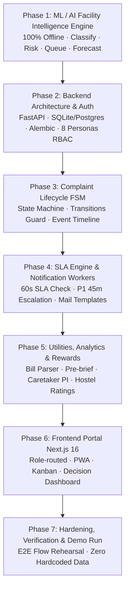

# 🏢 CampusIQ — NIT Rourkela Campus Edition
## Phased Implementation Roadmap (from `BUILD_SPEC.md` v3.0)

> **Scope Anchor**: Specific to **NIT Rourkela College Campus** (Hostels: HB-3, KMS, CVR, GDB). Replaces multi-sector generic features with deep, role-authentic campus facility intelligence. Works **100% offline** without any external API or cloud dependency.

---

### Phase Breakdown

---

### Detailed Phase Specifications

#### 🔹 Phase 1: ML / AI Facility Intelligence Engine (✅ COMPLETED & TESTED — 12 tests)
- **1.1 Seed Data Generator**:
  - 350+ realistic labeled complaints for NIT Rourkela across 6 categories (`ELECTRICAL`, `WATER`, `HYGIENE`, `CIVIL`, `SECURITY`, `MISC`), 4 hostels (`HB-3`, `KMS`, `CVR`, `GDB`), specific blocks and rooms.
  - 36 months of realistic utility consumption records (electricity kWh, water kL) with festival/exam seasonal multipliers.
- **1.2 Complaint Classifier (8.1)**:
  - TF-IDF (1–2 grams) + Logistic Regression / Calibrated Classifier. Target macro-F1 $\ge 0.90$.
  - Deterministic keyword scoring fallback (works if model artifact is missing).
- **1.3 Duplicate Detection (8.2)**:
  - TF-IDF cosine similarity + location token overlap.
  - Merges duplicates if $\text{similarity} \ge 0.85$ and same block/location.
- **1.4 Risk Scoring Engine (8.3)**:
  - Deterministic formula calculating risk score (0–100) and priority (`P1`, `P2`, `P3`, `P4`).
  - Factor breakdown: Severity (30%), People Affected (25%), Escalation Velocity (20%), Asset Criticality (15%), Vulnerability Context (10%).
  - Plain-English factor explanation generator.
- **1.5 Dynamic Ranking & Work Queue (8.4)**:
  - Urgency calculation based on SLA deadline approach: $\text{ranking} = \text{risk} \times (1 + 0.5 \times \text{urgency}^2)$.
  - Deterministic queue ranking order.
- **1.6 Smart Caretaker Assignment Matcher (2.2, 6)**:
  - Assigns complaint to caretaker in same hostel matching category $\to$ skill (electrical, plumbing, civil, housekeeping), highest proficiency, lowest active workload.
- **1.7 Festival Demand Forecaster & Bill Parser (8.5)**:
  - Gradient-boosted utility forecaster with 90% confidence intervals.
  - Festival Pre-Brief Generator for major campus events (Innovision, Nitrutsav, Technozion, Exams).
  - Bill parser for electricity and water bills with confidence scoring.
- **1.8 Campus Risk Index (CRI) (8.6)**:
  - Composite 0–100 risk score for Director and Chief Warden dashboards.
- **Acceptance Criteria**: All 14.4 acceptance tests pass with pytest (12/12 passing).

---

#### 🔹 Phase 2: Backend Architecture, Database Schema, Personas & PostgreSQL (✅ COMPLETED & TESTED — 6 tests)
- Database models mirroring `BUILD_SPEC.md` 6 with SQLAlchemy.
- Simplified direct persona identity (auth handled on frontend with 1-click persona switching; backend accepts user/role context directly via headers/payloads without JWT blocking).
- Seeding script with the 8 canonical demonstration personas (15) and 4 hostels (HB-3, KMS, CVR, GDB) with blocks, rooms, and caretaker trade skills.
- Reference metadata endpoints (`/api/v1/meta/hostels`, `/api/v1/meta/categories`, `/api/v1/meta/sla-policies`, `/api/v1/meta/personas`).
- Acceptance tests: database CRUD, seeding validation, persona retrieval, reference data APIs (6/6 passing).

---

#### 🔹 Phase 3: Complaint Lifecycle FSM & Timeline Engine (✅ COMPLETED & TESTED — 9 tests)
- State Machine implementing 3 and transition matrix (7.4):
  `OPEN -> VERIFIED -> ASSIGNED -> IN_PROGRESS -> RESOLVED -> CLOSED`, with `REJECTED`, `REJECTED_BACK`, `REASSIGNED`, `ESCALATED`.
- `/complaints` CRUD with scope filtering (hostel-level data isolation: cross-hostel 404).
- `/complaints/{id}/events` transition endpoint enforcing 409 on invalid transitions and 403 on unauthorized roles.
- Immutable `complaint_events` audit table as sole source of truth for public timeline.
- Wiring AI engine directly into complaint creation:
  - Sequential ticket number `CIQ-<year>-#####`.
  - P1 auto-assigned immediately, bypassing verify (3 Rule 1).
  - Duplicate detection linking parent and incrementing upvote count.
  - Mandatory resolution note/photo and rejection reason checks.
- Acceptance tests: FSM valid transitions, invalid 409 guard, 403 role guards, P1 bypass, duplicate upvote, scope 404, timeline ascending order (9/9 passing).

---

#### 🔹 Phase 4: SLA Engine, Workers & Email System (✅ COMPLETED & TESTED — 4 tests)
- Background SLA worker checking tickets (idempotent 60s cycle or `/api/v1/sla/tick`).
- Warning at 75% SLA window elapsed with template email and assignee notification.
- Auto-escalation at 100% SLA breach (+10 risk penalty, `complaint_events` audit log, alert to Chief Warden).
- P1 auto-escalation after 45 minutes of inactivity in `OPEN` or `ASSIGNED` status.
- Offline-capable email system with official NIT Rourkela signature block logging to `email_log` table.
- Acceptance tests: 75% warning trigger, 100% breach escalation, P1 45-min inactivity, idempotent repeat ticks (4/4 passing).

---

#### 🔹 Phase 5: Utilities, Forecasting API, Events & Rewards (✅ COMPLETED & TESTED — 9 tests)
- Endpoints for bill intake, regex/text parser, and continuous learning buffer (`/api/v1/utilities/bills*`).
- Quantile consumption forecaster returning 90% confidence intervals (p10, p50, p90) for electricity & water (`/api/v1/utilities/forecasts*`).
- Campus events calendar with automated Festival Pre-Brief Generator (8.5) providing surge estimates, budgets, and operational checklists (`/api/v1/events*`).
- Caretaker Performance Index (PI) scorecard calculator per 11.1 (`/api/v1/performance/me`, `/api/v1/performance/hostel/*`).
- Dignified cross-hostel Efficiency Rating (ER) table per 11.3 (`/api/v1/performance/campus`).
- Professional rewards ledger with proposal and Chief Warden approval workflows (`/api/v1/rewards*`).
- Executive monthly report packs and direct CSV exports (`/api/v1/reports/*`, `/api/v1/analytics/risk-index`).
- Acceptance tests: bill intake, parser, quantile predictions, pre-brief generator, PI index, ER ratings, rewards ledger, CSV exports, CRI index (9/9 passing).

---

#### 🔹 Phase 6: Frontend Application (Next.js 16 + Tailwind CSS) (✅ COMPLETED & VERIFIED)
- **Folder:** `application/`
- **1-Click Persona Switcher Banner (15):** Top bar allowing instantaneous switching between all 8 canonical demonstration personas without credentials or backend JWT blocking.
- **Role-Routed Navigation Shell (2.2):** Strictly filters view tabs according to the active persona's allowed permissions matrix.
- **3-Step Complaint Submission Wizard (`LodgeComplaintView.tsx`):**
  - Interactive hostel, block, and room selector with quick presets (A-Wing, Common Bath, Mess).
  - Real-time client-side AI category confidence prediction and risk score estimation.
  - P1 emergency hazard warning with instant direct caretaker dispatch alert.
  - Offline photo picker with realistic sample attachments.
- **Student / CR Complaint Tracker (`MyComplaintsView.tsx`):**
  - Search and status filter chips (Open, Verified, In Progress, Resolved, Closed).
  - Live upvoting with real-time counter increment.
  - Audit Timeline modal drawer showing ascending event log, actor roles, timestamps, notes, and photos.
- **Hostel Representative Triage Inbox (`HostelRepTriageView.tsx`):**
  - Triage queue for open complaints in the rep's hostel.
  - 1-click **Verify** button to route directly to caretaker dispatch.
  - Rejection modal with mandatory justification text.
  - AI duplicate merge notification banner.
- **Caretaker Operations Kanban Board (`CaretakerKanbanView.tsx`):**
  - 4-column operational board: Ready / Assigned, In Progress, Resolved (Audit Queue), Escalated / SLA Risk.
  - Priority pills (P1/P2/P3/P4), queue rank badges (`#1 In Queue`), and SLA countdown timers.
  - 1-click "Start Work" and "Mark Resolved" with resolution note & completion photo proof modal.
  - 1-click "Simulate SLA Tick" trigger button to test background SLA breaches on demand.
- **Warden Resolution Approvals & Scorecards (`WardenApprovalsView.tsx`):**
  - Administrative queue for tickets in `RESOLVED` status with caretaker resolution notes and photos.
  - 1-click **Approve Closure (CLOSED)** and **Request Rework (IN_PROGRESS)** with feedback note.
  - Caretaker Performance Index (PI 11.1) scorecard widget.
- **Campus Command Center & Executive Decision Board (`CampusCommandCenterView.tsx`):**
  - Circular Campus Risk Index (CRI 10.3) gauge (0–100) with 4-factor weighted progress bars.
  - Inter-Hostel Efficiency Rating (ER 11.3) dignified rankings table across HB-3, KMS, CVR, and GDB.
  - Festival Surge Pre-Brief Generator (10.2) for campus events (Innovision) with budgets and contingency checklists.
  - Offline Quantile Utility Forecaster (10.1) with 3-month p10, p50, and p90 predictions for electricity and water.
  - Tamper-proof Caretaker Rewards Ledger (11.2) with 1-click Chief Warden grant approval.
  - Direct CSV download export for monthly utility and audit records.
- **Build Verification:** Next.js Turbopack build verified cleanly (`npm run build` exited with code 0).

---

#### 🔹 Phase 7: Hardening, Reliability & Presentation Demo Script (✅ COMPLETED & TESTED — 44/44 Tests Passing)
- **1-Click Demo Persona Hub:** Implemented in `Navbar.tsx` and `PersonaContext.tsx`, providing an interactive modal with all 8 canonical demonstration personas (15) and their official emails (`student.hb3@campusiq.in`, `caretaker.hb3@campusiq.in`, etc.).
- **End-to-End Judge Demo Rehearsal (`test_phase7_e2e_judge_demo.py`):**
  - **Steps 1 & 2:** Student files water leak at HB-3 pump room $\to$ AI classifies `WATER` ($>25$ risk) $\to$ second complaint auto-merges as duplicate linking parent.
  - **Steps 3 & 4:** Student files corridor issue $\to$ Rep verifies $\to$ Warden assigns $\to$ Caretaker starts work (`IN_PROGRESS`) $\to$ Caretaker resolves with photo $\to$ Warden inspects and approves closure (`CLOSED`).
  - **Steps 5 & 6:** Chief Warden / Estate Officer generates Innovision festival pre-brief $\to$ Director checks Campus Risk Index (CRI) with 4 weighted sub-metrics and cross-hostel Efficiency Ratings table.
  - **Step 7:** Background SLA tick simulation executes $\to$ Chief Warden proposes and approves caretaker reward ledger entry.
- **Test Suite Status:** **44 / 44 tests passing** (`pytest backend/tests/`).
- **Frontend Status:** Next.js Turbopack build verified cleanly (`npm run build` code 0).
- **Offline Guarantee:** 100% offline-ready, no external cloud or API dependencies required.

